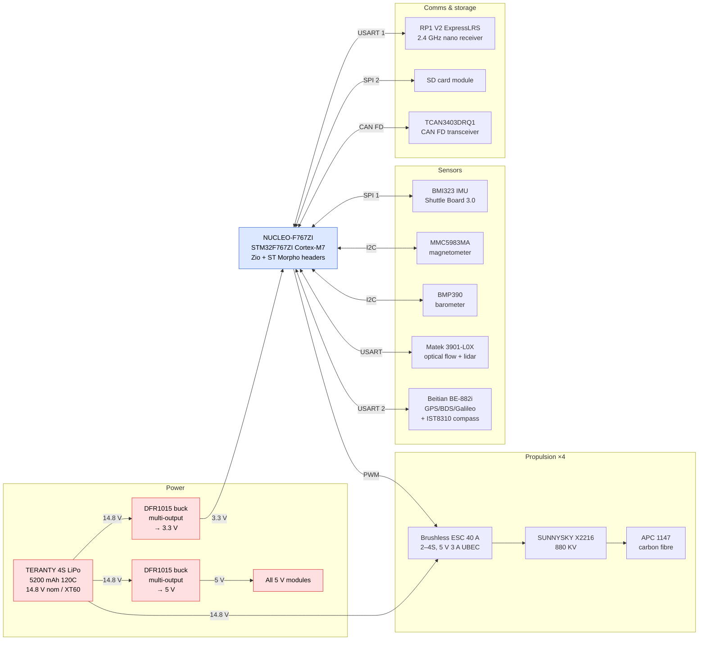

# MiBeesFly — High-Level Design

System architecture for the MiBeesFly flight controller: a custom carrier module built around an
**STM32 NUCLEO-F767ZI**, designed in KiCad, running C firmware written in STM32CubeIDE, flying a
450-class quadcopter.

**Status:** architecture defined — V0.1. Schematic not yet started.
**Last updated:** 16 November 2026

---

## 1. System block diagram

Everything above mounts on an **F450-class carbon fibre airframe**.

---

## 2. Power architecture

Battery voltage is distributed to three places, and **both logic rails come from dedicated
DC-DC converters rather than from the ESC BECs**.

| Rail | Source | Feeds |
|---|---|---|
| 14.8 V nominal | 4S LiPo, XT60 | 4× ESC, both buck converters |
| 5 V | DFR1015 buck #1 | All 5 V peripheral modules |
| 3.3 V | DFR1015 buck #2 | NUCLEO-F767ZI |

**Battery:** TERANTY 4S 5200 mAh 120C graphene, XT60, ~376 g.
**Converters:** 2× DFR1015 multi-output step-down, 7.5–30 V input.

### Why this matters

Taking the 5 V rail from a dedicated converter instead of the ESC BECs **avoids paralleling four
regulators**. The four 40 A ESCs each carry a 5 V 3 A UBEC; wiring those outputs together would set
up circulating currents between them, wasting power at best and killing a BEC mid-flight at worst.

> **Build rule:** because 5 V comes from the buck converter, the **red wire on all four ESC servo
> leads must be left disconnected**. Only the signal and ground lines go to the carrier.

### To verify before the schematic is finalised

- **Feeding the Nucleo at 3.3 V bypasses its on-board regulator.** UM1974's power-supply section
  covers using 3V3 as an input, along with what it means for ST-LINK and the board's protection
  circuitry. Confirm the current limit in that mode and what happens if USB and 3.3 V are connected
  at once during bench work.
- Current budget per rail, with headroom calculated for both converters.
- Reverse-polarity and inrush protection on the battery input.
- Where battery voltage and current sensing lives.

---

## 3. Compute

| | |
|---|---|
| Board | NUCLEO-F767ZI — Nucleo-144, ST board ID MB1137 |
| MCU | STM32F767ZIT6, Arm Cortex-M7 with double-precision FPU |
| Debug | On-board ST-LINK/V2-1, no external probe needed |
| Headers | Arduino Uno V3, ST Zio and ST Morpho |
| Reference | UM1974 (user manual), DB3171 (data brief) |

The Cortex-M7's **double-precision FPU** is the reason for this part. Attitude estimation and the
fusion filter are floating-point heavy, and hardware double precision removes a class of numerical
problems that would otherwise need careful handling on an M4.

The carrier board is a module that the Nucleo plugs into. That keeps MCU power, clocking, boot and
USB/debug circuitry off the first PCB spin — V0.1 only has to get sensors, power and connectors
right.

---

## 4. Interface allocation

| Interface | Peripheral | Protocol / notes |
|---|---|---|
| **SPI 1** | BMI323 IMU (Shuttle Board 3.0) | Highest-rate sensor; SPI chosen over I²C for sample rate. Needs a data-ready interrupt on an EXTI-capable pin |
| **SPI 2** | SD card module | Flight logging — raw sensor data, PID terms, motor outputs |
| **I²C** | MMC5983MA magnetometer | Shared bus |
| **I²C** | BMP390 barometer | Shared bus — check address conflict |
| **USART 1** | RP1 V2 ExpressLRS 2.4 GHz receiver | CRSF, typically 420 kbaud |
| **USART 2** | Beitian BE-882i GNSS | UBX/NMEA, default 115200 bps, 1 Hz |
| **USART** | Matek 3901-L0X flow + lidar | MSP protocol |
| **CAN FD** | TCAN3403DRQ1 transceiver | Expansion bus — see open items |
| **PWM ×4** | ESC signal outputs | Timer outputs; DShot would need timer + DMA and ESC support |

**Watch for:** pins already consumed on the Nucleo by the Ethernet PHY, USB, user LEDs and the user
button. UM1974 lists these, and CubeMX should be used to confirm the full map has no conflicts
before anything is drawn.

---

## 5. Propulsion

| | |
|---|---|
| Frame | F450-class carbon fibre, 4-axle |
| Motors | SUNNYSKY X2216 880 KV ×4, flat shaft — needs prop adapters |
| ESCs | Brushless 40 A, 2–4S, with 5 V 3 A UBEC ×4 (+1 spare), UBEC unused |
| Props | APC 1147 carbon fibre, 2 pairs per pack ×2 |
| Control | 4× PWM from the Nucleo, one per ESC |

**Prop sizing decision:** 1147 (11-inch) was chosen deliberately over 1045/1047, paired with the
low-Kv 880 KV motor to keep tip speed and current in range. See §7.

---

## 6. Sensor suite

The point of the sensor selection is **drift-free position hold in both environments** — GNSS
outdoors, optical flow plus lidar indoors, with the IMU and barometer tying the two together.

| Sensor | Part | Bus | Role |
|---|---|---|---|
| IMU | Bosch **BMI323** on Shuttle Board 3.0 | SPI 1 | Gyro + accelerometer — the core of attitude estimation |
| Magnetometer | MMC5983MA | I²C | On-board heading reference |
| Barometer | BMP390 | I²C | Altitude hold and vertical velocity |
| Optical flow + lidar | Matek 3901-L0X | USART | Ground-relative velocity and low-altitude range — indoor position hold |
| GNSS + compass | Beitian BE-882i | USART 2 | Absolute position and heading outdoors. GPS + BDS + Galileo, IST8310 compass on board |
| Logging | SD card module | SPI 2 | Blackbox data for tuning |

The MMC5983MA and BMP390 were originally flagged as *"possibly redundant"* in the parts list. That
was true against a commercial flight controller, which has them built in — building a custom
carrier makes them **required**.

---

## 7. Design decisions

| Decision | Choice | Reasoning |
|---|---|---|
| MCU | STM32F767ZI on NUCLEO-F767ZI | Cortex-M7 double-precision FPU for the fusion filter; Nucleo module keeps MCU support circuitry off the V0.1 PCB |
| IMU | BMI323 on Shuttle Board 3.0 | Bosch shuttle board allows bring-up and evaluation before committing the part to a PCB footprint |
| IMU bus | SPI, not I²C | I²C cannot sustain the sample rate a rate loop needs |
| 5 V source | Dedicated DFR1015 buck | Avoids paralleling four ESC BECs |
| 3.3 V source | Dedicated DFR1015 buck | Direct rail for the Nucleo |
| Motors | X2216 **880 KV** | Low Kv chosen specifically to allow larger, more efficient props |
| Props | APC **1147** | Paired with the 880 KV motor rather than the higher-Kv alternative — larger slower-turning props are more efficient in hover |
| Logging | SD over SPI 2 | PID tuning without logs is guesswork |
| Expansion | CAN FD via TCAN3403DRQ1 | Robust multi-drop bus for future peripherals |

---

## 8. Open items

Carried from the issue tracker — these need closing before or during schematic capture.

| | Item | Why it matters |
|---|---|---|
| 🔴 | **Verify the 1147 / 880 KV / 4S current draw** | The low-Kv choice is sound reasoning, but it should be confirmed against SunnySky's published thrust table and then measured on the bench, props on, with a clamp meter or power analyser. The number to watch is sustained current per motor against the X2216's limit |
| 🔴 | **Nothing is specified on the CAN bus** | The transceiver is in the design but no CAN node is. Decide what it talks to — smart ESCs, a second MCU, external telemetry — since that drives termination, connector choice and whether a 120 Ω resistor belongs on the carrier |
| 🟠 | **IST8310 vs MMC5983MA** | The BE-882i carries its own IST8310 compass. Decide whether it is used, ignored, or fused with the MMC5983MA, and confirm whether its I²C lines share the carrier's I²C bus and conflict |
| 🟠 | **Receiver model mismatch** | The parts list has the RadioMaster XR1 bundled with the Pocket transmitter; this design shows an RP1 V2 nano receiver. Both are ELRS/CRSF, so the interface is unchanged — reconcile which one is actually flying |
| 🟠 | **Carrier mating: ST Morpho vs Zio** | With one SPI for the IMU, a second for SD, shared I²C, three UARTs, CAN FD and four timer outputs, Zio's pin count may be too tight. UM1974 has the tables to confirm |
| 🟡 | **ESC protocol: PWM vs DShot** | DShot needs no calibration and suits a tuned loop, but requires timer + DMA and ESC firmware support. The generic 40 A ESCs may be PWM-only — confirm before committing timer allocation |
| 🟡 | **Mass and thrust budget** | A Nucleo-144 is heavier than a commercial FC. Confirm thrust-to-weight stays near 2:1 with everything fitted |
| 🟡 | **Power sensing location** | On the carrier or on a separate board |

---

## 9. Changes from the original parts list

| Item | Then | Now |
|---|---|---|
| Flight controller | "Still needed" | NUCLEO-F767ZI + custom carrier |
| IMU | Not in BOM | **BMI323** on Shuttle Board 3.0 |
| Power distribution | "Still needed" | 2× DFR1015 buck converters |
| 5 V source | ESC UBEC assumed | Dedicated buck converter |
| Props | 1147 flagged as oversized | 1147 **kept deliberately**, paired with 880 KV motors |
| CAN | Not considered | TCAN3403DRQ1 CAN FD transceiver |
| Logging | Not considered | SD card module on SPI 2 |

---

## 10. References

Held in `(1)HIghLevelDesign&(NOTES)/STMN32UCLEOBOARD/`:

- **UM1974** — STM32 Nucleo-144 user manual. Connector pinouts, solder bridges, power-supply modes
- **DB3171** — Nucleo-144 data brief. Confirms NUCLEO-F767ZI → STM32F767ZIT6, board MB1137
- **MB1137 Altium source + `MB1137.pdf`** — ST's reference schematics. The PDF is the usable form,
  since the project is in KiCad
- **TN1235** — ST-LINK derivatives overview

