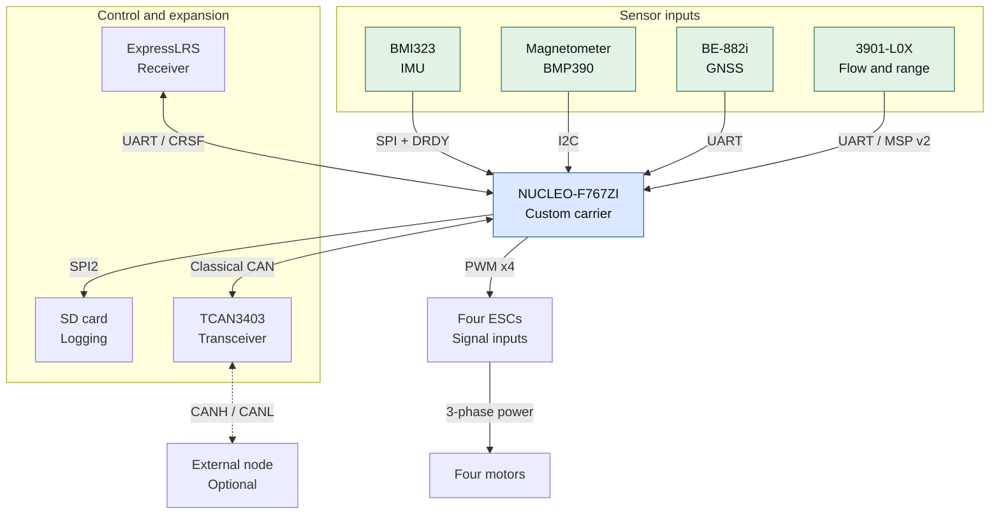
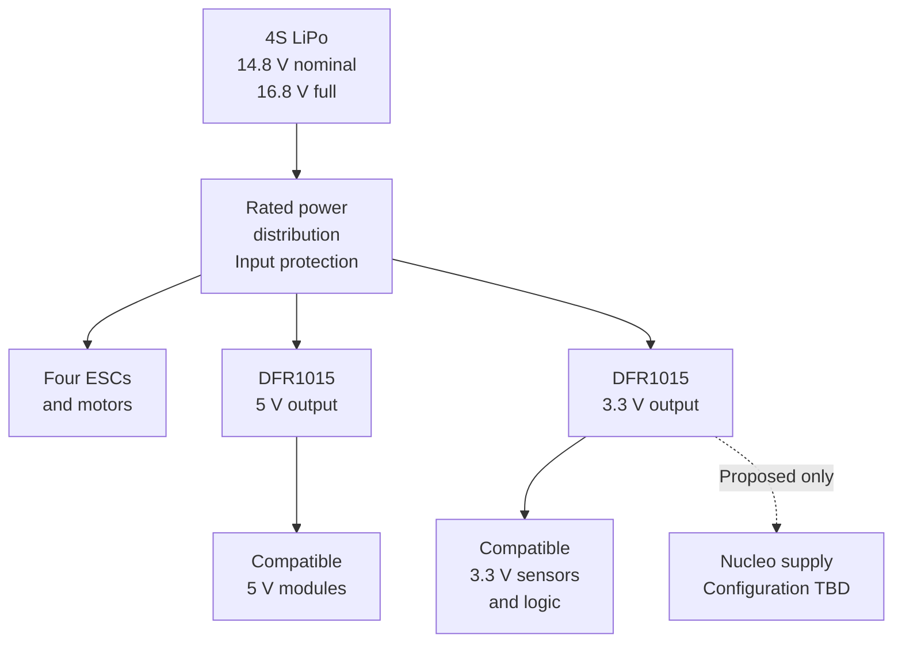

# MiBeesFly 🐝


I'm building a quadcopter flight controller from scratch: a carrier module I'm designing in **KiCad**
around an **STM32 NUCLEO-F767ZI**, running **C firmware** I'm writing in **STM32CubeIDE**, flying a
450-class quad. GPS, compass, optical flow, lidar and barometer are fused so it holds position
without drifting — indoors and out.

> **⚠️ Work in progress.** Nothing here has flown. The architecture is defined; the schematic, the
> carrier PCB and the firmware are all still ahead. Treat everything below as current intent, not a
> finished design.

**Last updated:** 16 November 2026 &nbsp;·&nbsp; **Tracking:** [Issues](https://github.com/mohanan02/MiBeesFly/issues) · [Milestones](https://github.com/mohanan02/MiBeesFly/milestones)

## Contents

1. [Status and roadmap](#status-and-roadmap)
2. [Why build it instead of buying one](#why-build-it-instead-of-buying-one)
2. [Goals and scope](#goals-and-scope)
3. [System architecture](#system-architecture)
4. [Power](#power)
5. [Interface allocation](#interface-allocation)
6. [Sensors](#sensors)
7. [Airframe and propulsion](#airframe-and-propulsion)
8. [Design decisions](#design-decisions)
9. [Open items](#open-items)
10. [Build cost and shopping list](#build-cost-and-shopping-list)
11. [Repository layout](#repository-layout)
12. [Safety](#safety)
13. [References](#references)
14. [Changelog](#changelog)
15. [License](#license)

---

## Status and roadmap

**The design is done on paper.** Every major part is chosen, the system architecture is drawn, and
the next thing I touch is KiCad. There's no schematic or firmware yet, and a few
[open items](#open-items) need closing before the schematic is final.

```
Overall progress   ████░░░░░░░░░░░░░░░░   ~20%
```

| Milestone | Scope | Progress |
|---|---|---|
| — | Research and parts procurement | `█████████░` 95% — 13 orders placed |
| **M1** | High-level design — parts, power tree, interfaces, block diagram | `█████████░` 90% — open items remain |
| **M2** | Carrier schematic in KiCad | `░░░░░░░░░░` 0% — **next** |
| **M3** | PCB layout | `░░░░░░░░░░` 0% |
| **M4** | Fabrication and remaining parts ordered | `░░░░░░░░░░` 0% |
| **M5** | Assembly and soldering | `░░░░░░░░░░` 0% |
| **M6** | Board bring-up — rails metered on a current-limited supply before the Nucleo goes in, then one sensor at a time | `░░░░░░░░░░` 0% |
| **M7** | Sensors online — drivers in C | `░░░░░░░░░░` 0% |
| **M8** | Stabilised flight — attitude estimation, rate and angle loops, arming, failsafe, first hover | `░░░░░░░░░░` 0% |
| **M9** | Autonomous position hold — GNSS + baro outdoors, flow + lidar indoors, clean handover between them | `░░░░░░░░░░` 0% |

Work is tracked as 33 issues across these 9 milestones.

---

## Why build it instead of buying one

Off-the-shelf controllers like Matek, Pixhawk and SpeedyBee are cheap and work well — buying one
would be faster and cheaper, so this isn't about saving money. I want to own the whole stack:
schematic capture, PCB layout, sensor drivers, the fusion filter and the control loops. When I'm
done, every sensor reading and every motor output should trace back to code I wrote and copper I
laid out.

One consequence: a commercial FC has its IMU, magnetometer and barometer built in, and a bare Nucleo
has none. That's why the BMI323, MMC5983MA and BMP390 are on the carrier. The original parts list
flagged the last two as possibly redundant — against a commercial FC they would be, but here they're
required.

---

## Goals and scope

V0.1 combines a NUCLEO-F767ZI, a custom carrier PCB, external sensor modules and custom C firmware on a 450-class quadcopter.

The first objective is reliable sensor acquisition and stabilised flight. Altitude hold and position hold follow once the power system, motor outputs, control timing and failsafes have been tested.

| Operating mode | Planned measurements | Intended result |
|---|---|---|
| Stabilised flight | Gyroscope and accelerometer | Controlled angular rates and attitude |
| Altitude hold | IMU and barometer; range measurements when valid | Maintain a commanded height within measured limits |
| Outdoor position hold | GNSS, IMU, heading reference and height estimates | Maintain position when GNSS quality is adequate |
| Indoor position-hold experiments | IMU, optical flow and valid ground range | Limit motion over a suitably lit, textured surface |

**Zero drift is not a specification.** Position error, height error and sensor availability must be measured under stated conditions. Optical flow does not provide an absolute position reference, and operation outside valid sensor conditions requires a defined fallback.

FPV video and a fully integrated MCU board are later additions. They are not prerequisites for the first electronics bring-up. CAN expansion is optional until an actual peripheral is selected.

## System architecture

### Carrier-board approach

The Nucleo supplies the MCU platform and debugging interface. The carrier provides the selected power connections, sensor/module interfaces, ESC signal connectors, logging connection and optional expansion circuitry.

For V0.1, the BMI323 is planned as a shuttle-board module. Each remaining sensor must be identified as a breakout module or a bare IC before assigning its footprint and supply circuit. A module name alone is not enough to define a PCB interface.

[](%281%29HIghLevelDesign%26%28NOTES%29/MiBeesFly_HighLevelDesign_v0.1.png)

*High-level design v0.1 — click for full resolution. The original drawing (6617 × 3625) is the
source of truth; the copy shown here is downscaled to 2400 px wide for page load.*

### Signal connections

This diagram shows logical connections. It does not assign MCU pins, connector pin numbers or supply voltages.



The GNSS module's compass, if used, belongs to the magnetometer connection; do not assume its readings arrive in the GNSS UART stream. Confirm its separate interface and wiring on the exact module.

The [original V0.1 drawing][legacy-drawing] is retained as a historical reference. Its CAN FD label and any conflicting details are superseded by this page. Update that drawing before using it as a current wiring reference.

</details>

Everything mounts on an F450-class carbon fibre airframe. The design has three layers:

| Layer | What it is | Status |
|---|---|---|
| **Compute** | NUCLEO-F767ZI, plugged into the carrier as a module | ✅ Selected |
| **Carrier module** | Custom KiCad PCB carrying the sensors, power regulation, ESC signal headers and the connectors for GNSS, radio, CAN and logging | 🚧 Schematic not started |
| **Firmware** | C in STM32CubeIDE — sensor drivers, fusion filter, attitude and position loops, motor mixing, receiver input, failsafe | 🚧 Not started |

### Compute

| | |
|---|---|
| Board | NUCLEO-F767ZI — Nucleo-144, ST board MB1137 |
| MCU | STM32F767ZIT6, Arm Cortex-M7 with double-precision FPU |
| Debug | On-board ST-LINK/V2-1 — no external probe needed |
| Headers | Arduino Uno V3, ST Zio and ST Morpho |
| Peripherals that matter here | Up to 4 USARTs + 4 UARTs, 6 SPIs, 4 I²C, 3 CAN (classical 2.0B), 2 SDMMC |

Using the Nucleo as a module keeps MCU power, clocking, boot and USB/debug circuitry off the first
PCB spin, so V0.1 only has to get sensors, power and connectors right. A fully integrated board is a
later revision.

---

## Power

### Proposed distribution



Both logic rails come from dedicated DC-DC converters, not from the ESC BECs.

| Rail | Source | Feeds |
|---|---|---|
| 14.8 V nominal (16.8 V full) | 4S LiPo — TERANTY 5200 mAh 120C graphene, XT60, ~376 g | 4× ESC, both buck converters |
| 5 V | DFR1015 buck #1 | 5 V peripheral modules — exact list still open |
| 3.3 V | DFR1015 buck #2 | NUCLEO-F767ZI — [under review](#open-items) |

Both converters are DFR1015 multi-output step-downs with a 7.5–30 V input, which covers a 4S pack
from full charge down to cutoff.

The four ESCs each carry a 5 V 3 A UBEC. Wiring those together would parallel four regulators, and
small differences between them set up circulating currents — wasted power at best, a dead BEC
mid-flight at worst. A single dedicated 5 V converter avoids that.

> **Build rule:** because 5 V comes from the buck converter, the **red wire on all four ESC servo
> leads stays disconnected**. Only signal and ground go to the carrier.

---

## Interface allocation

| Interface | Peripheral | Protocol / notes |
|---|---|---|
| **SPI 1** | BMI323 IMU (Shuttle Board 3.0) | Highest-rate sensor. Needs a data-ready interrupt on an EXTI-capable pin |
| **SPI 2** | SD card module | Blackbox logging — raw sensor data, PID terms, motor outputs |
| **I²C** | MMC5983MA magnetometer + BMP390 barometer | Shared bus. Addresses don't collide (MMC5983MA 0x30, BMP390 0x76/0x77) — confirm against the breakouts |
| **USART 1** | RP1 V2 ExpressLRS 2.4 GHz receiver | CRSF, 420 kbaud by default. Telemetry goes back to the transmitter on the same link |
| **USART 2** | Beitian BE-882i GNSS | UBX/NMEA, default 115200 bps at 1 Hz |
| **UART — TBD** | Matek 3901-L0X flow + lidar | MSP. Peripheral not picked yet — anything except USART 3 |
| **CAN** | TCAN3403DRQ1 transceiver | The F767's CAN controllers are classical CAN 2.0B (bxCAN), not CAN FD. The transceiver is FD-capable, but the bus will run classical CAN at up to 1 Mbit/s |
| **Timer ×4** | ESC signal outputs | PWM for now, at a multirotor rate (~400 Hz) rather than 50 Hz servo rate. Put all four on one timer's four channels so they update together |
| **ADC** | Battery voltage | Not in the design yet — see [open items](#open-items) |
| **USART 3** | ST-LINK virtual COM port | **Reserved.** Wired to PD8/PD9 on the Nucleo — keep it free as a printf debug console |

**Pins the Nucleo already uses.** The Ethernet PHY, USB OTG, user LEDs and user button all occupy MCU
pins, and some collide with common peripheral pin choices — PA7, for example, is a usual SPI1 MOSI
pin and also an Ethernet RMII line on this board. Lay the full map out in CubeMX, checked against
UM1974's pin tables, before anything is drawn.

---

## Sensors

The sensor set is chosen for **drift-free position hold in both environments**: GNSS outdoors,
optical flow plus lidar indoors, with the IMU and barometer tying the two together.

| Sensor | Part | Bus | Role | Status |
|---|---|---|---|---|
| IMU | Bosch **BMI323** on Shuttle Board 3.0 | SPI 1 | Gyro + accelerometer — the core of attitude estimation | Selected, not ordered |
| Magnetometer | MMC5983MA | I²C | On-board heading reference | Awaiting delivery (×2) |
| Barometer | BMP390 | I²C | Altitude hold and vertical velocity | Awaiting delivery (×2) |
| Optical flow + lidar | Matek 3901-L0X | UART | Ground-relative velocity and low-altitude range — indoor position hold | Ordered |
| GNSS + compass | Beitian BE-882i — M10, GPS + BDS + Galileo, IST8310 compass | USART 2 | Absolute position and heading outdoors | Ordered |
| Logging | SD card module | SPI 2 | Blackbox data for tuning | Selected, not ordered |

---

## Airframe and propulsion

| | |
|---|---|
| Frame | F450-class carbon fibre, 4-axle |
| Motors | SunnySky X2216 **880 KV** ×4 — flat shaft, needs prop adapters |
| ESCs | 40 A, 2–4S, with 5 V 3 A UBEC ×4 (+1 spare) — UBEC unused |
| Props | APC **1147** carbon fibre — 2 packs of 2 pairs |
| Battery | 4S 5200 mAh 120C LiPo, XT60, ~376 g |
| Radio | RadioMaster Pocket (ELRS) transmitter + RP1 V2 nano receiver |
| Control | 4× timer output from the Nucleo, one per ESC |

---

## Design decisions

| Decision | Choice | Reasoning |
|---|---|---|
| MCU | STM32F767ZI on NUCLEO-F767ZI | The fusion filter and control loops are floating-point heavy. The Cortex-M7's double-precision FPU removes a class of numerical problems that need careful handling on an M4 |
| Board approach | Carrier module around a Nucleo | Keeps MCU support circuitry off the V0.1 PCB. The Morpho headers bring nearly every pin out, which is what makes a carrier work |
| IMU | BMI323 on Shuttle Board 3.0 | The shuttle board allows bring-up and evaluation before committing the part to a footprint |
| IMU bus | SPI, not I²C | Far more bandwidth and lower read latency at the sample rates a rate loop wants |
| 5 V source | Dedicated DFR1015 buck | Avoids paralleling four ESC BECs — see [Power](#power) |
| 3.3 V source | Dedicated DFR1015 buck | Direct rail for the Nucleo — being reconsidered, see [open items](#open-items) |
| Motors and props | X2216 880 KV with APC 1147 | Low Kv chosen so I can swing a larger, slower-turning prop, which is more efficient in hover. The original parts list flagged 1147 as oversized; I kept it deliberately over 1045/1047 |
| Logging | SD card | Tuning PIDs without logs is guesswork, so logging earns its place early |
| Expansion | CAN via TCAN3403DRQ1 | Robust multi-drop bus for future peripherals |

---

## Open items

These need closing before or during schematic capture. 🔴 high · 🟠 medium · 🟡 low

| | Item | Why it matters |
|---|---|---|
| 🔴 | **Nucleo power input** | Feeding 3.3 V into the 3V3 pin bypasses the on-board regulator and leaves the ST-LINK unpowered, so there's no on-board programming or debugging while the Nucleo sits on the carrier. UM1974 also requires SB3 (3.3 V regulator) and SB111 (NRST) to be removed, or the ST-LINK section cut off. The alternative is feeding 5 V from buck #1 into **E5V**: the on-board regulator stays in use and the ST-LINK still works, provided E5V is powered before USB is plugged in. Decide before the schematic — it changes which header pins carry power |
| 🔴 | **Verify the 1147 / 880 KV / 4S current draw** | The low-Kv reasoning is sound, but 11-inch props on 4S is where the X2216 gets closest to its limit. Check sustained current per motor against SunnySky's published thrust table, then measure it on the bench with props on, using a clamp meter or power analyser |
| 🔴 | **Nothing is on the CAN bus yet** | The transceiver is in the design but no CAN node is. Decide what it talks to — smart ESCs, a second MCU, external telemetry — since that drives termination, connector choice and whether a 120 Ω resistor belongs on the carrier. DroneCAN peripherals run on classical CAN, so the 2.0B-only controller doesn't rule them out |
| 🟠 | **Supply rail for each module** | The design shows 5 V going to "5 V modules" and 3.3 V to the Nucleo, but not which rail feeds each sensor. The bare BMI323, BMP390 and MMC5983MA chips are 3.6 V-max parts, so check whether each breakout has its own regulator before choosing its rail, and pull the I²C bus up to 3.3 V |
| 🟠 | **Battery voltage and current sensing** | A low-battery failsafe needs at least a resistor divider from the pack into an ADC pin; a current sensor adds mAh used. Decide whether it lives on the carrier or a separate board |
| 🟠 | **IST8310 vs MMC5983MA** | The BE-882i carries its own IST8310 compass. Decide whether it's used, ignored, or fused with the MMC5983MA, and whether its I²C lines join the carrier's bus |
| 🟠 | **Receiver model mismatch** | The parts list has the RadioMaster XR1 bundled with the Pocket; this design shows an RP1 V2. Both are ELRS/CRSF so the interface doesn't change — confirm which one is actually flying |
| 🟠 | **Carrier mating: ST Morpho vs Zio** | Two SPIs, shared I²C, three UARTs, CAN, four timer outputs, an ADC and an EXTI line may be too much for Zio alone. UM1974 has the tables to confirm |
| 🟡 | **ESC protocol: PWM vs DShot** | DShot needs no calibration and suits a tuned loop, but needs timer + DMA and ESC firmware support. The generic 40 A ESCs may be PWM-only — if so, OneShot125 is a faster analogue option worth checking. Confirm before committing timer allocation |
| 🟡 | **SD card: SPI module vs native SDMMC** | The F767 has two SDMMC controllers. A microSD socket on SDMMC in 4-bit mode logs much faster than SPI and frees SPI 2. Check pin availability on the Nucleo, and decide before the SD module is bought |
| 🟡 | **Mass and thrust budget** | A Nucleo-144 is heavier than a commercial FC. Confirm thrust-to-weight stays near 2:1 with everything fitted |
| 🟡 | **Prop clearance** | On a 450 mm frame, adjacent motors are about 318 mm apart, so 11-inch props leave roughly 40 mm between tips. Check clearance to the frame plates, landing gear and GPS mast as well |
| 🟡 | **Power budget and input protection** | Current budget per rail, with headroom for both converters. Reverse-polarity and inrush protection on the XT60 input |
| 🟡 | **Status indication** | No buzzer or status LED on the carrier yet. Both are cheap, make arming state, failsafe and low battery obvious from the ground, and a buzzer helps find a downed quad |

---

## Build cost and shopping list

**NZ$960 so far**, across 13 orders, parts and shipping included. I already had 18650 cells for the
transmitter.

Still to buy:

- **LiPo balance charger** — this blocks every powered test, not just flight
- BMI323 shuttle board and SD card module
- FPV camera, VTX and antenna, and goggles or a phone receiver
- Assembly bits: battery strap, XT60 connectors, GPS mast, vibration dampers, LiPo bag, wire, heat shrink

Everything is tracked in `(4)Drone_Build_ComponentsList.xlsx`, including a **Still Needed** sheet.

---

## Repository layout

```
(1)HIghLevelDesign&(NOTES)/
    MiBeesFly_HighLevelDesign_v0.1.png       Original drawing, full resolution
    MiBeesFly_HighLevelDesign_v0.1_web.png   Downscaled copy used in this README
    MiBeesFly_NOTES.docx                     Working notes
    STMN32UCLEOBOARD/                        ST reference docs: UM1974, DB3171, TN1235, MB1137 source
(2)Hardware/
    MiBeesFly_FC_V0.1(PCB)/                  KiCad carrier project        [not started]
    SchematicPDF/                            Exported schematics for review
(3)Firmware(Software)/                       STM32CubeIDE C project       [not started]
(4)Drone_Build_ComponentsList.xlsx           Parts ordered, costs, parts still needed
(5)FullyAssemble/                            Assembly notes, wiring, photos, test logs
```

---

## Safety

A 450 quad with 11-inch props on 4S isn't a toy, and I'm treating it that way.

- **Props off the motors for every bench test.** No exceptions.
- Power rails metered on a current-limited supply before the Nucleo ever goes into the carrier.
- LiPos charged and stored in a fire-safe bag.
- No armed testing until I have a failsafe path I've actually verified.
- First flights tethered or in open space, well clear of people.
- Flying within **CAA Part 101** here in New Zealand.

---

## References

ST documentation, held in `(1)HIghLevelDesign&(NOTES)/STMN32UCLEOBOARD/`:

- **UM1974** — STM32 Nucleo-144 user manual: connector pinouts, solder bridges, power-supply modes
- **DB3171** — Nucleo-144 data brief; confirms NUCLEO-F767ZI → STM32F767ZIT6, board MB1137
- **MB1137 Altium source + `MB1137.pdf`** — ST's reference schematics. The PDF is the usable form, since this project is in KiCad
- **TN1235** — ST-LINK derivatives overview

Not in the repo yet, but needed once firmware starts: the STM32F767 datasheet (**DS11532**) and
reference manual (**RM0410**).

---

## Changelog

| Date | What I did |
|---|---|
| 2026-11-16 | Merged the wiki home page and `Architecture.md` into this README. Design review added open items for the Nucleo power input, sensor supply rails, battery sensing, SDMMC logging and prop clearance; CAN corrected to classical 2.0B |
| 2026-11-16 | **Architecture complete** — BMI323 IMU selected, power tree defined, CAN and SD logging added, full block diagram drawn |
| 2026-11-15 | Added 33 issues across 9 milestones; wiki created |
| 2026-11-14 | Added ST reference docs and MB1137 Altium source; renamed `(3)Software` → `(3)Firmware(Software)` |
| 2026-11-12 | Created `Architecture.md` |
| 2026-11-10 | Rewrote the README with a full project description and status badges |
| 2026-11-08/09 | Placed the first 10 parts orders |

---

## License

Apache License 2.0 — see [LICENSE](LICENSE).

ST reference material under `(1)HIghLevelDesign&(NOTES)/STMN32UCLEOBOARD/` is STMicroelectronics'
work, distributed under ST's own terms, not Apache 2.0.
